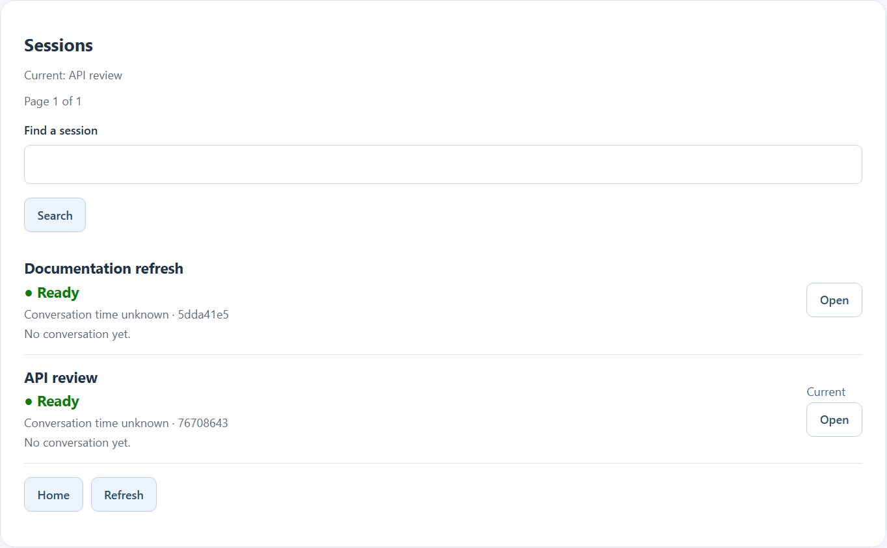
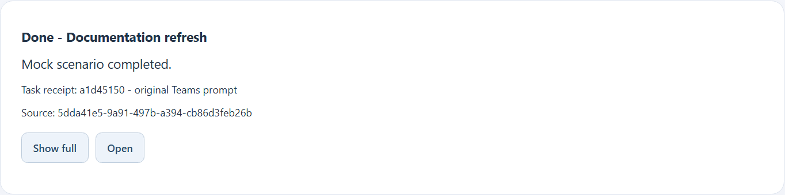
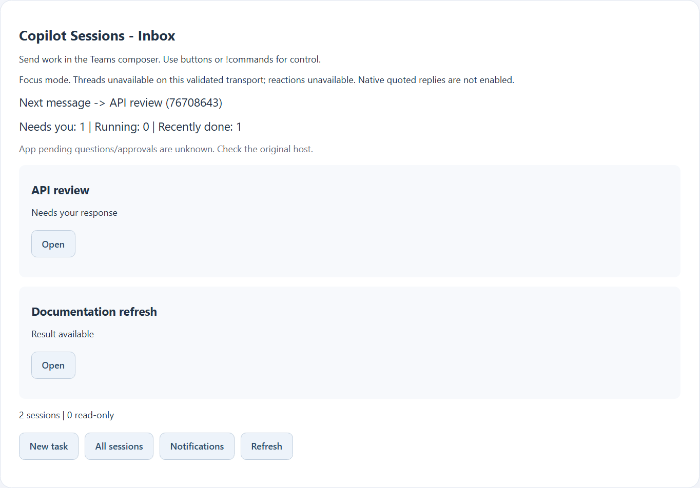

# Copilot Teams Client

A self-hosted, single-owner bridge between a **personal Microsoft Teams bot chat**
and your local Copilot sessions. Use Teams' normal message composer to talk to an
explicit, visible Focus target. Quiet acknowledgements, answer-first replies and
a searchable **All actions** panel keep control separate from work text.

This is an independent project, not an official Microsoft or GitHub product.
It is not a hosted service or a multi-user bot.

**A Teams app ZIP is only a client manifest and icons.** Uploading it does not
register an Azure Bot, run this backend, install Copilot, or keep your computer
online. Every operator supplies their own work/school tenant, bot registration,
owner identity, Copilot entitlement/sign-in, private `.env`, and local state.
No shared portal, existing installation, or another operator's credentials are
required for the direct-webhook route below.

## Start here

| What you need | Where to go |
| --- | --- |
| Use an already installed bot from your phone | [Phone workflow in pictures](#phone-workflow-in-pictures) |
| Set up your own bot | [Prerequisites](#prerequisites-and-compatibility), then [first run](#first-run-independent-authenticated-webhook) |
| Connect existing App/CLI sessions | [Endpoint installation](extensions/teams-session-endpoint/README.md) |
| Try the UI without accounts or cloud calls | Build the source, run `npm run simulate`, then open `http://127.0.0.1:3979` |
| Look up a command | [Everyday use](#everyday-use) |

## Phone workflow in pictures

After [installing your own bot](#6-build-and-import-your-personal-teams-app),
open its personal chat in Teams on your phone. Keep the computer, original
Copilot host, bridge backend, and configured network route running.

**These are cropped screenshots of an earlier bundled local MOCK layout, not
native Teams screenshots.** All names, IDs, requests, and results are synthetic.
The current UI uses the quieter controls described below; run the local preview
for the current cards without Teams credentials, model calls, or tool execution.
Native Teams and mobile layouts can differ.

### 1. Find a session and check the target

Send **`!sessions`**, or tap **All sessions** in the Inbox. Enter a name in
**Find a session**, tap **Search**, then **Open** on the intended session.
Check **Next message ->** in the current header before sending work.



To switch again, tap **Change next target** in the current session header.
That entry, and **All sessions** from the Inbox, now post a fresh picker near
the latest chat activity instead of editing an old off-screen message.
Search, page navigation, and Refresh stay on that picker.

Opening the picker alone does **not** switch the target. **Open** selects the
source and posts one compact session card at the bottom of the chat, even if
you explicitly reopen the same session. It does not send a task, read older
messages, or post a history snapshot. If names are ambiguous, use
**`!use <canonical-session-ID>`** instead.

The card shows the source and its observed status. If short public excerpts
are already available, **You** and **Copilot** have separate labels. Tap **Recent
conversation** for a bounded, read-only view. To post full-length messages,
expand **Full history**, choose a count and tap **Post full history**. Longer
messages may span several chat activities only when you explicitly request them.

### 2. Send work, then read the result

Use the normal Teams message composer for the task, for example:
`Summarize the README quick start.`
The bridge forwards that text unchanged to the selected writable source.
Only commands starting with **`!`** control the bridge.

Fast replies arrive without an extra task card. A slower task gets one compact
status activity, updated in place: **Received by bridge**, **Accepted by source**
or **Running - execution observed** are different facts. This is not a native
typing indicator. Answers show the actual response first, not a generic task
completion summary. **Show full** appears only for longer answers. **Details**
holds source/receipt diagnostics; **All actions** includes history and controls.



Changing the next-message target does not move earlier tasks or their results
to another session. An uncertain send is not permission to resend the prompt.

### 3. Check what needs you

Send **`!home`** to open the Inbox. It shows the next-message target, observed
requests, running work, and recent results. Opening the Inbox itself does not
change the target.



For **bot-created sessions**, use the separate request card to answer a question
or review an offered approval. Stop requires its own confirmation. For
**existing App/CLI sessions**, permissions and controls stay in the original
host; the Inbox does not guess whether that host is waiting for approval.
See [owned-session controls](#owned-session-controls) for the exact limits.

An accepted task follows its source for 24 hours by default unless you explicitly
unsubscribed. Use **Subscribe / Unsubscribe** on the header or a picker row;
these never select a different source or send it work. An explicit unsubscribe
survives later tasks and restart. It never suppresses direct task replies.

## Prerequisites and compatibility

- A Windows computer that can remain running. The Teams ZIP builder requires
  Windows (`System.Drawing`); use PowerShell 7. The existing-session integration
  has Windows-oriented host/file-layout assumptions. Linux, macOS, containers,
  remote hosts, and unattended-service deployments are not validated here.
- Node.js 24 LTS or a newer supported release, and npm. The declared engine range
  also permits Node 22.12+, but current Node 24+ is recommended.
- Your own Microsoft 365 **work/school** account with Teams. The tenant must allow
  custom app uploads and use of the bot. A personal Microsoft account alone is
  not sufficient. Azure subscription/resource permissions and Entra application
  registration/secret permissions are needed to register the bot.
- An HTTPS reverse proxy or tunnel reachable by the Teams/Bot service, forwarding
  to your local backend. You supply and operate it; this repository provisions
  no cloud resources, DNS, TLS certificates, tunnels, services, or startup tasks.
  Azure, tunneling, and Copilot usage may incur charges.
- For **existing-session writes**, a compatible Copilot App/CLI preview host that
  supports extensions, `@github/copilot-sdk/extension` `joinSession()`,
  `session.send()`, and the local session journal format. Install the included
  [endpoint extension source](extensions/teams-session-endpoint/README.md)
  manually in the original host. These APIs and App metadata are not universal
  stable interfaces; the npm SDK alone does not provide App attachment.
- For optional **bot-created sessions**, a Copilot account with access to the
  pinned SDK's native runtime and a model it actually advertises. Dependencies
  are pinned, including `@github/copilot-sdk` 1.0.31; do not replace the SDK or
  host with an arbitrary version and assume compatibility.

Python 3 with `jsonschema` is needed only for optional local Teams-schema
validation. No Python package is needed to run the bridge or build the ZIP.

## First run: independent authenticated webhook

### 1. Get and build the source

Extract the source ZIP, or clone the repository URL supplied by its publisher.
Run these commands from that source directory:

```powershell
npm ci --registry=https://registry.npmjs.org
npm run build
Copy-Item .env.example .env
```

Edit **`.env`**, never `.env.example`, with your private values. The example
explicitly sets `BRIDGE_TRANSPORT=webhook`. Omitting that variable retains the
legacy relay default; it does not auto-detect a webhook or fall back to mock.

For a no-account UI preview instead, run `npm run simulate` and open
`http://127.0.0.1:3979`. It is explicitly **MOCK**, uses synthetic sessions and
loopback-only HTTP, and makes no real Teams sends or model calls. Stop it with
Ctrl+C. Do not expose the simulator through your tunnel; it is not the bot.

### 2. Register your own bot

In your own tenant, create an Entra application and an **Azure Bot** resource
using that application's ID. Choose **single-tenant** identity for this setup.
Configure a client secret for that application and record its **secret value**
privately, not its secret ID. Set the bot's Microsoft App ID and tenant to the
same registration. The direct adapter uses client-secret authentication; this
guide does not configure managed-identity authentication.

In the Azure Bot resource:

1. Enable the **Microsoft Teams** channel and complete any required channel
   configuration/terms for your tenant.
2. Set **Configuration -> Messaging endpoint** to your own public HTTPS URL,
   ending in **`/api/messages`**, for example
   `https://bot.example.test/api/messages` (illustrative, not a working service).
3. Keep the bot application's secret on the backend only. Never put it in the
   manifest, ZIP, support URL, browser, Teams message, or source repository.

See Microsoft's [bot registration guide](https://learn.microsoft.com/en-us/azure/bot-service/bot-service-quickstart-registration?view=azure-bot-service-4.0).
Registration connects the bot to channels; it does not deploy this Node process.

### 3. Configure the backend privately

The required `.env` settings are:

| Setting | Value |
| --- | --- |
| `BRIDGE_TRANSPORT` | `webhook` |
| `TEAMS_APP_ID` | The bot registration's application/client GUID, not an application object ID |
| `TEAMS_APP_SECRET` | That application's current client-secret **value** |
| `TEAMS_TENANT_ID` | Your work/school directory/tenant GUID |
| `TEAMS_OWNER_OBJECT_ID` | Your user object's Entra object GUID **in that tenant**, not an email or bot/service-principal ID |
| `BRIDGE_WORKSPACES` | JSON array of 1-20 allowed existing absolute local paths, with unique `id` and readable `name` |

Keep `BIND_HOST=127.0.0.1` and `PORT=3978` for a tunnel/reverse proxy on the same
computer. `BRIDGE_STATE_DIRECTORY=.bridge` keeps private bot state separate from
source. JSON paths in `.env` require doubled backslashes; follow `.env.example`.

The default `TEAMS_SERVICE_HOSTS` are exact trusted commercial Teams service
hosts. Do not replace them with your tunnel hostname, wildcards, or IP addresses:
they validate the Bot service's **outbound conversation service URL**, not your
inbound webhook URL. Other cloud environments require separate compatibility
work and are not advertised as supported.

The official Microsoft Agents JWT validator authenticates inbound requests
before the bridge accepts a reference. The bridge additionally checks the
audience, tenant, owner, personal-only conversation, bot recipient, and trusted
service URL. Do not remove those checks to work around setup errors. The
manifest's personal scope is **not** an authorization boundary.

### 4. Enable the session route you need

For existing local sessions, follow
[the endpoint manual-install and reload instructions](extensions/teams-session-endpoint/README.md).
Keep the **original** session open, with its endpoint loaded and root journal
readable by the same OS account running the bridge. Missing or stale endpoints
mean read-only history; the bridge does not wake or take over offline sessions.
App-owned mode, tools, permissions, and approvals remain with the original host.
No separate bot SDK sign-in or model is needed for these existing-session sends.

For bot-created sessions instead, set `COPILOT_APP_SESSIONS=false` if you do not
want local App discovery. With `COPILOT_AUTH=logged-in-user`, run:

```powershell
npm run login:copilot
npm run models
```

These are real account/runtime operations, not offline checks. Complete your own
official sign-in, then set `COPILOT_DEFAULT_MODEL` in `.env` to an exact model ID
from that catalogue. A compatible runtime may also offer
`npm run login:copilot -- --provider entra`; support depends on that runtime and
your entitlement. Never copy credentials from another App profile. Explicit
token/runtime alternatives are commented in `.env.example`, not auto-selected.

The private SDK starts lazily only for bot-owned operations or explicit
`!control <instruction>`. Browsing existing sessions does not start a management
agent. `BRIDGE_WORKSPACES` limits bot-created workspaces; it is not an OS sandbox
and does not replace an existing host's tool permissions.

### 5. Check configuration, then keep the backend and HTTPS route running

```powershell
npm start -- --check
npm start
```

`--check` validates local configuration without starting a Bot listener, SDK,
endpoint, login, or model call. It does **not** validate Azure credentials, Teams
channel configuration, tunnel reachability, or host extension compatibility.

Keep the second command running. In another terminal, start your chosen HTTPS
tunnel/reverse proxy targeting **`http://127.0.0.1:3978`**, preserving
`POST /api/messages`, its JSON body, and the Authorization header. The public
webhook must be reachable by the Bot service without an interactive browser
login/interstitial; the backend's JWT authentication must still remain enabled.
Expose only the intended backend routes, never repository files, the simulator,
Copilot endpoints, or local broker/state directories.

`http://127.0.0.1:3978/health` checks the local process. A healthy response does
not prove Teams delivery or Copilot sign-in. An unauthenticated request to
`/api/messages` should be rejected, not return a useful bot response.
If the public hostname changes, update the Azure Bot messaging endpoint.
Sleep, loss of network, a stopped tunnel, or a stopped backend prevents delivery.
Ctrl+C stops the foreground process; no automatic startup is installed.

### 6. Build and import your personal Teams app

Use the **same bot application ID** as `TEAMS_APP_ID`:

```powershell
.\teams-package\New-TeamsPackage.ps1 `
  -BotId "<your-bot-application-guid>" `
  -WebsiteUrl "https://example.test/support" `
  -PrivacyUrl "https://example.test/privacy" `
  -TermsUrl "https://example.test/terms" `
  -OutputPath "..\copilot-sessions.zip"
```

Replace the placeholders and `example.test` URLs with your own actual HTTPS
support/privacy/terms pages. The script creates only `manifest.json`, a 192x192
color icon, and a 32x32 outline icon using original generated artwork.

On **Teams desktop or web**, sign in as the configured owner in the configured
tenant: **Apps -> Manage your apps -> Upload an app -> Upload a custom app**,
select the ZIP, then **Add/Open** for personal use. Labels may vary by client.
If upload is unavailable, contact your Teams administrator; do not bypass policy.
See [the complete package guide](teams-package/README.md).

Send **`!help`**, then **`!sessions`**. After installation on desktop/web, open
the **same bot chat** in Teams mobile using the **same account and tenant**.
Mobile is a client for that installed bot, not a backend host or a replacement
for the computer/tunnel. Availability and card rendering depend on tenant policy
and the mobile client; no separate mobile sideload flow is promised.

## Everyday use

| Message | Effect |
| --- | --- |
| `!sessions` | Find a source |
| `!use <name or ID>` | Select that exact source and show one compact session card; no automatic history |
| `!history` / `!history 20` | Post full-length readable messages (10 by default, or an explicit count from 1 to 50) |
| `!status` | Show the selected source and notification state |
| `!subscribe` | Follow the exact selected source without expiry; observation is journal-backed or explicitly live-only |
| `!unsubscribe` | Mute passive notifications, not explicit task replies or outstanding receipts |
| `!home` | Open the Inbox without changing the next-message target |
| `!help` | Show commands and capabilities |

Type ordinary work in Teams' native composer. Without a selected source, nothing
is forwarded. Only explicit `!` commands manage the bridge. Plain `Home`,
`Sessions`, `history`, and `control:` are literal work, not old menu commands.
Unknown/malformed `!` commands fail rather than becoming an agent prompt.

Root sessions and side chats have independent canonical identities, history,
admissions, and subscriptions. A parent subscription never includes its children.
Reading history or changing a view does not subscribe, switch the selected send
target, or silently start another session. Optional `COPILOT_APP_METADATA_DB`
enables read-only side relationships from an explicitly selected compatible App
database; no database is auto-discovered, migrated, or written.

Host acceptance, observed execution, confirmed results, and Teams delivery are
different states. Uncertain admissions/deliveries are retained and **never
automatically resent**. Subscriptions start at the current local journal cursor,
not historical output. Restart reconciliation is read-only and does not replay
work. Native management peers without a correlatable message ID stay read-only.
The included core preserves durable history/outbox formats: new complex-text
messages use the v4 escaped basic-HTML/XML fallback, while already persisted
legacy payloads are not rewritten or reposted.

### If something looks stuck

| Symptom | Next action |
| --- | --- |
| A switch button seems to do nothing, or an old card is stale | Send `!sessions` and use the latest picker; select a row with Open, then check Next message ->. |
| A source is read-only | Keep its original host open and verify the endpoint is loaded. History access alone does not make a source writable. |
| An existing App session appears to need approval | Check that session in the original App/CLI. Remote App approval state is not inferred. |
| A task or delivery says uncertain | Read `!status` and `!history`, and inspect the original session before deciding what to do. Do not blindly resend work. |
| The bot stops replying | Check the computer, backend, and tunnel or relay. Importing the Teams ZIP does not keep any of them running. |

### Interaction v3

The Inbox shows observed needs-you/running/recent-result state. App approval and
question state remains **unknown** unless the original host exposes authoritative
evidence; a busy heartbeat is not a permission request. Native request cards have
their own signed surface, so changing focus or refreshing the Inbox does not
invalidate another pending request.

The Focus header, session picker and Inbox use the same host-derived session
status text and semantic colors. They update on observed events and catalogue/
liveness changes even while another view is selected. Session availability is
not the completion state of an individual task; unknown/read-only states remain
explicit. The current header offers **Recent conversation**, **Subscribe /
Unsubscribe**, **Change next target**, and **All actions**. Unsupported subscriptions show their
reason instead of a pretend working button.

Opening **All sessions** or **Change next target** from an independent Inbox,
header or task card posts a fresh picker near the latest chat activity. Search,
pagination and Refresh update that same picker. Opening it does not change the
selected destination or send work; choose **Open** on the desired session.

**All actions** is a working, searchable, paged control panel, not just command
documentation. It is bound to the source from which it was opened, independently
of the next-message target. It prioritizes Steer/Stop for an observed owned task,
then groups sessions, notifications, history, model/mode, diagnostics and optional
explicit Control. Search for `model`, `history`, `approval` or `control` and use
the offered form. Native questions/approvals retain their exact request IDs;
Stop still requires a separate confirmation. The Steer opener and submit are
both bound to the originally offered turn. App-only operations are explained,
never implemented by assuming ownership. Source IDs, tool/queue details and
receipts stay under deliberate **Details**. First contact with no target shows
**Choose a session**, `!sessions` and `!help`; ordinary text is not silently sent.

An accepted Teams task automatically follows that source for 24 hours only if it
has no explicit unsubscribe preference. Explicit `!subscribe` has no expiry.
Unsubscribe persists through later tasks and restart; only an explicit Subscribe
enables it again. Legacy `muted` entries do not identify whether a user muted or
an automatic period expired: they are preserved without guessing and require
explicit Subscribe. Newly recorded automatic expiry can renew on later tasks.
App following uses the
existing durable local cursor; owned SDK sessions are **live-only**, with no
automatic reconnect or invented catch-up cursor. Existing paused subscriptions
stay paused. Following capacity/failures are reported separately from the task's
direct result obligation.

There is a short acknowledgement grace period so a fast actual answer can arrive
alone. During delayed liveness/connection/send checks, a compact **Received by
bridge - not yet accepted** hint cannot be mistaken for a native ACK. Slow
requests use at most one status activity updated in place; no typing activity is
invented on relay or webhook. The final answer is a separate new activity with
actual answer text first. Short answers have no redundant Show full button;
long answers use a bounded preview and **Show full**. Full content is published
through the existing measured chunk formatter as read-only history. Generic
native completion summaries never replace answer text. Prior replies keep their
original source and recipient after switching. Failed/uncertain delivery remains
explicit and is never automatically replayed.

Three or more passive source notifications within 60 seconds can form
one digest; direct task replies are never folded into it. Individual passive
notifications may wait for that collection window.
Digests group by canonical source, not display title or result count. Larger
collections use bounded pages/batches; the final signed activity is checked
before any member is claimed. Remainders stay queued rather than being lost.

`BRIDGE_STATUS_UPDATE_SECONDS` defaults to 5 (minimum 2); state transitions can
update immediately. `BRIDGE_FOLLOW_HOURS` defaults to 24 (minimum 1). Values must
fit the validated timer range. Rendering cards and following do not start an SDK.

The Store now writes **schema 5**. Opening schema 1, 2, 3 or 4 validates the same owner and
atomically preserves its sources, receipts, admissions, subscription cursors and
all legacy outbox bytes/statuses. Earlier readers reject schema 5 rather than
ignore explicit unsubscribe intent or the independent picker/Actions surfaces.
No historical uncertain send becomes replayable. A controlled
upgrade must stop the single writer and retain a consistent private backup.
After any newly accepted work, restoring an older database is **not a safe
rollback**: it can lose deduplication and receipt facts. Retain the schema-aware
binary/state and review a forward fix or an explicit offline downgrade instead.
See the [design and implementation record](docs/design/interaction-v3.md).

`BRIDGE_THREADS` and `BRIDGE_REACTIONS` accept `auto` (default) or `off`.
**Both transports currently remain in Focus mode**: preview thread posting,
native quotes and reactions are not enabled merely because a different SDK
documents them. This is a working fallback, not a startup error. The endpoint
and relay wire capabilities are not expanded.

An authenticated reply with thread metadata but no supported binding is retained
as an **unsent draft**, not sent to the old Focus target. Its Routing card offers
a writable source or explicit creation in an allowed workspace. Only Send once /
Create and send once forwards the original unchanged text. Drafts expire after
the action TTL (normally 15 minutes), with at most 16 pending drafts; an uncertain
attempt has no retry action. Refresh choices can replace an unattempted stale UI,
not replay accepted work. The Inbox exposes pending drafts.

Containing-chat IDs establish checked aliases for opaque conversation IDs;
existing conversation-keyed receipts/cursors are not rewritten. Conflicting
identities fail closed rather than merge sources. No opaque ID is parsed to
invent a root. Unprefixed text remains work, and `!` commands work in both places.
The optional remembered-target UI and persistent session-thread bindings are
withheld until actual thread support is verified; Focus keeps its explicit
visible selection instead. Current headers update independently of Inbox
navigation, and older Focus headers are frozen without cancelling their tasks.

### Owned-session controls

Bridge-created working sessions keep **manual permissions**. Permission cards
show redacted command/file/tool details, **Allow once**, **Deny** with optional
feedback, and **Allow for this session** only for native-advertised command/write
scopes. Managed one-shot or sandbox-escalation requests cannot receive a broader
grant. Oversized/incomplete approval details disable Allow rather than approve
unseen work. No permanent/location grant is offered. Questions keep their exact
native choices; plan approval keeps the actual offered continuation actions.

`BRIDGE_REMOTE_APPROVALS=off` genuinely disables new remote permission and plan
approvals: permissions return `user-not-available`, plans decline, and no Allow
controls are offered. It does not revoke a previous native grant, stop work, or
turn on `allow-all`. With approvals on, `BRIDGE_APPROVAL_TIMEOUT_MINUTES` defaults
to 15; expired permissions return `user-not-available` and plans decline.
RPC uncertainty is shown honestly, without retrying an approval or a prompt.

**Stop**, including `!stop` and Control's stop tool, requires a separate owner
confirmation. It targets the currently processing message in the exact owned
session; queued/background work may remain. **Steer** on an observed owned turn
sends unchanged text with `immediate`; ordinary work uses `enqueue`. A steering
ACK is not consumption or a separate completed task. Native-origin results retain
the original task address, even after changing Focus. Existing App sessions never
gain Stop, remote approval, mode/model changes or takeover.

Structured forms remain **unavailable** in the pinned remote UI. The public
elicitation callback omits its request ID, so the bridge does not enroll a
misleading form capability or guess correspondence by text/order. An observed
form is a read-only needs-you notice for the original native UI; it cannot be
answered from the composer or an approval card. Its actual native completion
clears the notice. This also avoids preempting another client's first response.

## Private state and operational limits

Keep `.env`, bot secrets, SDK profiles, broker files, conversation journals,
generated personal ZIPs, and `.bridge` private. State lives under
`.bridge\bots\<bot-application-id>` and is bound to the bot/owner/tenant/transport.
It can contain message content, authenticated conversation references, and signed
action material; it is **not** sanitized public telemetry.

Use a dedicated trusted OS account and restrictive Windows ACLs. POSIX file mode
bits are not Windows access controls. Local broker access is a trust boundary:
another process with write access can submit work. This is single-owner,
single-process software, not hardened multi-tenant hosting.

Do not share state across operators or remove a lock while its recorded process
is alive. After a crash, verify the process is gone before manually removing only
this bridge's lock. Never delete Copilot's own locks or copy another user's
profile. No automatic retention or deletion job is installed.

The [optional trusted relay](docs/relay.md) is an alternative transport only.
It is not supplied or required for the webhook setup.

## Development and clean source distribution

```powershell
npm run typecheck
npm test
.\teams-package\Test-TeamsPackage.ps1
npm run check:source
npm run pack:source -- --output "..\copilot-teams-client-source.zip"
```

`npm test` builds and runs the network/child-process-blocked suite with synthetic
config and explicitly permitted loopback fixtures. It does not sign in, create
cloud resources, send Teams messages, or run a native model. Packaging tests use
a fake bot registration. These checks are not an end-to-end certification of
your real tenant or host. `smoke:native` is a separate developer diagnostic that
starts a native runtime; it is not part of setup or the default test suite.

The source packer uses an **explicit file allowlist**, not a recursive copy or
Git history. It rejects redirected source paths, common credential patterns, and
non-public npm lockfile URLs. It writes the ZIP outside the source tree and
prints a file/hash inventory for private release review. Unknown files, build
output, local settings, generated Teams packages, and task evidence are excluded.
Do not distribute an arbitrary checkout archive or run `Compress-Archive *`.
Review the exact inventory/content before publishing: a pattern scan is not a
guarantee that arbitrary text contains no private information.

Source licensing is [MIT](LICENSE); dependencies and hosted products retain their
own licenses and terms. See [third-party notices](THIRD_PARTY_NOTICES.md).
